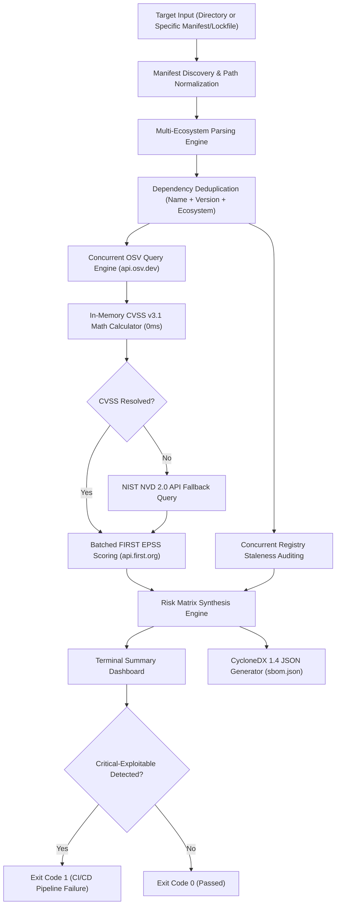

# Dependency Risk Tracker

Dependency Risk Tracker is a high-performance software composition analysis (SCA) and vulnerability intelligence tool written in Go. It discovers, analyzes, and scores security vulnerabilities and maintenance risks across modern multi-language software projects.

The tool inspects declaration manifests and lockfiles to reveal both direct and hidden transitive dependencies. It correlates findings against the Open Source Vulnerabilities (OSV) database, calculates CVSS base scores locally in memory, incorporates FIRST Exploit Prediction Scoring System (EPSS) probabilities, audits package maintenance staleness across official registries, and generates standard CycloneDX 1.4 Software Bill of Materials (SBOM) documents.

---

## Key Capabilities

* **Recursive Multi-Ecosystem Discovery**: Automatically traverses project directory trees to detect manifests and lockfiles across frontend, backend, and microservice stacks in a single scan.
* **Transitive Dependency Resolution**: Parses exact lockfiles across 10 major package managers to detect vulnerabilities in deeply nested sub-dependencies that declaration manifests omit.
* **Aggregated Vulnerability Intelligence**: Queries the OSV database (aggregating GitHub Security Advisories, NIST NVD, Go Vuln DB, RustSec, PyPA, and distribution security feeds).
* **Instant In-Memory CVSS v3.1 Engine**: Computes exact CVSS base scores directly from vector strings in memory (sub-millisecond execution) using official FIRST specification formulas, eliminating slow external network calls and rate-limiting delays.
* **Exploitation Likelihood (FIRST EPSS)**: Queries FIRST.org EPSS scores in batches to predict the real-world probability of exploitation within 30 days.
* **Upstream Registry Maintenance Auditing**: Queries public ecosystem registries (npm, PyPI, Crates.io, Go Proxy, Maven Central, NuGet, Packagist, RubyGems) concurrently to identify unmaintained packages untouched for more than two years.
* **Standardized CycloneDX 1.4 SBOM**: Exports a complete machine-readable software inventory in CycloneDX 1.4 JSON format with standard Package URLs (PURLs) and security metadata.
* **Automated CI/CD Gating**: Exits with a non-zero status code (code 1) when critical exploitable vulnerabilities are discovered, allowing automated pipeline blocking.

---

## Supported Ecosystems and File Formats

Dependency Risk Tracker automatically detects and parses the following declaration manifests and exact lockfiles:

| Ecosystem / Platform | Target Language | Supported Lockfiles (Transitive) | Supported Manifests (Direct) | Upstream Registry |
| :--- | :--- | :--- | :--- | :--- |
| **npm** | JavaScript, TypeScript | `package-lock.json`, `yarn.lock`, `pnpm-lock.yaml` | `package.json` | registry.npmjs.org |
| **PyPI** | Python | `poetry.lock`, `Pipfile.lock` | `requirements.txt` | pypi.org |
| **Go** | Go | `go.sum` | `go.mod` | proxy.golang.org |
| **crates.io** | Rust | `Cargo.lock` | `Cargo.toml` | crates.io |
| **Packagist** | PHP | `composer.lock` | `composer.json` | repo.packagist.org |
| **RubyGems** | Ruby | `Gemfile.lock` | (Parsed via lockfile) | rubygems.org |
| **Maven** | Java, Kotlin, Scala | (Resolved dependency tree) | `pom.xml` | search.maven.org |
| **NuGet** | C#, F#, .NET | `packages.lock.json` | `.csproj`, `packages.config` | api.nuget.org |

When a directory contains both a lockfile and a loose manifest for the same ecosystem (such as `package-lock.json` alongside `package.json`), the scanner automatically prioritizes the lockfile to ensure all transitive dependencies are captured without duplicate scanning.

---

## Architectural Workflow



---

## Risk Scoring Model

Vulnerabilities are evaluated against both impact severity (CVSS) and weaponization probability (EPSS):

| Priority Tier | Qualification Criteria | Description |
| :--- | :--- | :--- |
| **CRITICAL-EXPLOITABLE** | CVSS >= 7.0 and EPSS >= 0.20 (20%+ likelihood) | Severe security vulnerabilities with high probability of active real-world exploitation. Triggers CI/CD failure. |
| **HIGH** | CVSS >= 7.0 (EPSS < 0.20) | High severity flaws lacking immediate indicators of widespread active weaponization. |
| **MEDIUM** | 4.0 <= CVSS < 7.0 | Moderate security defects requiring scheduled patching. |
| **LOW** | 0.0 < CVSS < 4.0 | Low impact vulnerabilities or defense-in-depth findings. |
| **NONE** | No CVEs detected | Package has no known security advisories in official databases. |

---

## Installation

### Prerequisites
* Go 1.22 or higher installed on your system.

### Build from Source
```bash
git clone https://github.com/nyumuharon/dependency-tracker.git
cd dependency-tracker
go build -o dep-tracker .
```

Verify installation:
```bash
./dep-tracker
```

---

## Usage

### 1. Recursive Repository Scan
Scan an entire project or repository directory. The crawler automatically searches all subfolders while ignoring non-source paths (`.git`, `node_modules`, `vendor`, `.venv`, `dist`, `build`, etc.):

```bash
# Scan current directory
./dep-tracker scan .

# Scan an external repository path
./dep-tracker scan /path/to/my-project
```

### 2. Single Manifest or Lockfile Scan
Scan an individual file directly:

```bash
# Scan an npm lockfile (uncovers direct + transitive packages)
./dep-tracker scan package-lock.json

# Scan a Python Poetry lockfile
./dep-tracker scan poetry.lock

# Scan a Go module file
./dep-tracker scan go.mod
```

---

## Sample Report Output

```text
Scanning directory: .
Discovered 2 manifest(s)/lockfile(s):
  • go.mod
  • package-lock.json

Total unique dependencies to analyze: 3

========================================================================
DEPENDENCY RISK TRACKER — SCAN REPORT
========================================================================

[+] express (npm)
    Current Version : 4.18.2
    Latest Version  : 5.3.0
    Status          : ACTIVE
    Priority Tier   : MEDIUM
    Vulnerabilities (2):
      - CVE-2024-43796 (GHSA-qw6h-vgh9-j6wx) [CVSS: 5.0 | EPSS: 0.00486]
        Summary : express vulnerable to XSS via response.redirect()
      - CVE-2024-29041 (GHSA-rv95-896h-c2vc) [CVSS: 6.1 | EPSS: 0.00786]
        Summary : Express.js Open Redirect in malformed URLs

[+] qs (npm)
    Current Version : 6.5.1
    Latest Version  : 6.16.1
    Status          : ACTIVE
    Priority Tier   : HIGH
    Vulnerabilities (3):
      - CVE-2022-24999 (GHSA-hrpp-h998-j3pp) [CVSS: 7.5 | EPSS: 0.15622]
        Summary : qs vulnerable to Prototype Pollution
      - CVE-2026-82417 (GHSA-4mjr-xmp4-gh2g) [CVSS: 5.3 | EPSS: 0.00418]
        Summary : qs: Denial of Service via Attacker Controlled isBuffer

[+] cookie (npm)
    Current Version : 0.4.0
    Latest Version  : 2.0.1
    Status          : ACTIVE
    Priority Tier   : LOW
    Vulnerabilities (1):
      - CVE-2024-47764 (GHSA-pxg6-pf52-xh8x) [CVSS: 0.0 | EPSS: 0.00744]
        Summary : cookie accepts cookie name, path, and domain with out of bounds characters

========================================================================
                       SUMMARY
========================================================================
Total Packages Scanned : 3
Ecosystems Scanned     : npm (1)
Total Vulnerabilities  : 6
Stale Packages         : 0

Priority Tier Breakdown:
  CRITICAL-EXPLOITABLE : 0
  HIGH                 : 1
  MEDIUM               : 1
  LOW                  : 1
  NONE                 : 0
========================================================================

SBOM saved to sbom.json
```

---

## Software Bill of Materials (SBOM)

Every scan generates a standard CycloneDX 1.4 JSON document saved to `sbom.json`. Each component entry contains:
* Standardized Package URL (`purl`, e.g., `pkg:npm/qs@6.5.1`, `pkg:golang/github.com/gin-gonic/gin@v1.9.1`).
* Upstream version and staleness status (`risk:staleness`, `risk:latestVersion`).
* Assigned priority tier (`risk:priorityTier`).
* Embedded CVE identifiers with associated CVSS and EPSS ratings (`vuln:cveID`).

---

## Exit Codes for CI/CD Integration

| Exit Code | Condition | Meaning |
| :--- | :--- | :--- |
| `0` | Clean or Non-Critical | All packages passed risk policies; no `CRITICAL-EXPLOITABLE` defects found. |
| `1` | Policy Violation | One or more `CRITICAL-EXPLOITABLE` dependencies identified, or invalid command arguments. |

Example integration in GitHub Actions or GitLab CI:

```bash
./dep-tracker scan . || {
  echo "Security scan failed: Critical exploitable dependencies detected."
  exit 1
}
```

---

## License

This project is licensed under the MIT License.
