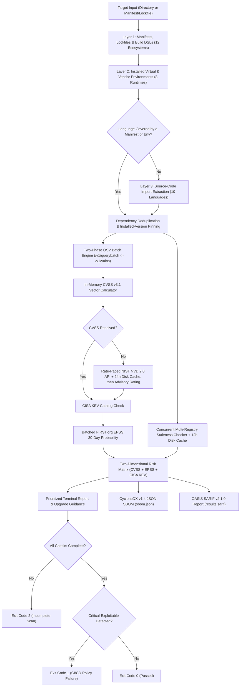

# Dependency Risk Tracker

**Dependency Risk Tracker (`dep-tracker`)** is a high-performance, zero-dependency Software Composition Analysis (SCA) and supply-chain vulnerability intelligence CLI tool written in Go. It discovers, analyzes, and prioritizes security vulnerabilities and maintenance risks across modern software projects in any programming language—even when a project lacks a lockfile or manifest.

The tool combines a **Three-Layer Intelligent Dependency Discovery Engine** with a **Two-Phase Batch OSV & NVD Vulnerability Pipeline**, an in-memory **CVSS v3.1 Vector Calculator**, **FIRST.org EPSS** 30-day exploitation probabilities, **CISA Known Exploited Vulnerabilities (KEV)** catalog alerts, **Multi-Registry Staleness Auditing**, and automated generation of **CycloneDX v1.4 SBOM** (`sbom.json`) and **OASIS SARIF v2.1.0** (`results.sarif`) compliance reports.

---

## Key Capabilities

* **Three-Layer Intelligent Dependency Discovery**:
  * **Layer 1 — Manifests, Lockfiles & Build DSLs**: Recursively detects and parses 30+ manifest, lockfile, and build DSL formats across **12 ecosystems** (npm/Yarn/pnpm, PyPI/Poetry/Pipenv/uv/Conda, Maven/Gradle, NuGet/.NET, Cargo/Rust, Go Modules, Composer/PHP, RubyGems/Bundler, Conan/vcpkg/CMake, Dart/Flutter Pub, Elixir Mix, and Swift Package Manager). Lockfiles take precedence over manifests in every ecosystem, and manifest details that change what is installed (`go.mod` `replace`, npm/Yarn aliases, Cargo renames, Maven managed versions, `requirements.txt` includes and hashes) are applied.
  * **Layer 2 — Installed Virtual & Vendor Environment Introspection**: Inspects **8 installed environment formats** when lockfiles are absent: Python virtual environments (any folder with `pyvenv.cfg`, plus `venv`/`.venv`), Node `node_modules/*/package.json`, .NET `obj/project.assets.json`, PHP `vendor/composer/installed.json`, Go `vendor/modules.txt`, Ruby `vendor/bundle/**/*.gemspec`, C/C++ `vcpkg_installed/vcpkg/status`, and Dart `.dart_tool/package_config.json`. The installed version replaces the declared one, including a manifest pin that the environment does not match.
  * **Layer 3 — Source-Code Imports**: Extracts third-party imports from source files across **10 programming language families** (`.py`, `.js`/`.ts`/`.jsx`/`.tsx`, `.go`, `.rs`, `.c`/`.cpp`/`.h`/`.hpp`, `.java`/`.kt`, `.cs`, `.php`, `.rb`, and `.dart`) wherever no dependency source covers that language, filters out standard-library and project-local modules, maps import names to canonical registry packages, and labels their versions as unresolved rather than assuming that the latest registry release is installed.
* **High-Speed Two-Phase Batch OSV Engine**: Uses a pooled HTTP/2 transport (`MaxIdleConnsPerHost: 32`) to query `/v1/querybatch` in batches of up to 1,000 resolved packages, then concurrently fetches full query results for packages with matching advisories. Advisories that alias each other are merged, and withdrawn advisories and RustSec "unmaintained" notices are left out.
* **Instant In-Memory CVSS v3.1 Vector Calculator & Cached NVD 2.0 Fallback**: Computes exact CVSS v3.1 base scores in memory from vector strings using the official FIRST.org equations. Advisories without one fall back to the NIST NVD CVE 2.0 API (CVSS v3.1, v4.0, v3.0 or v2), paced to NVD's rate limit, retried on rate-limit responses and cached for 24 hours (`nvd_cache.json`), and then to the advisory database's own rating.
* **CISA KEV & FIRST EPSS Exploitability Prioritization**: Cross-references every CVE against CISA's Known Exploited Vulnerabilities (KEV) catalog and queries FIRST.org EPSS in batches to compute a two-dimensional risk priority (`CRITICAL-EXPLOITABLE`, `HIGH`, `MEDIUM`, `LOW`), with `UNKNOWN` for advisories whose severity no source provides.
* **Fast Multi-Registry Staleness Auditing**: Audits package maintenance health concurrently across npm, PyPI lightweight RSS release feeds (`~10 KB` instead of multi-MB JSON payloads), Maven Central, NuGet, Crates.io, Go Proxy, Packagist, RubyGems, ConanCenter, Pub.dev, and Hex.pm with a 12-hour local disk cache (`staleness_cache.json`), flagging packages whose newest stable release is more than 2 years (730 days) old.
* **CycloneDX v1.4 SBOM & OASIS SARIF v2.1.0 Export**: Automatically generates `sbom.json` (with standardized PURLs, unique `bom-ref`s, a serial number and embedded CVSS/EPSS/KEV ratings) and `results.sarif` (for GitHub Code Scanning and CI/CD inline PR annotations, with repository-relative locations and one fingerprint per affected package).

---

## Supported Ecosystems & Three-Layer Discovery Matrix

### Layer 1: Manifests, Lockfiles & Build DSLs

| Ecosystem / Platform | Languages | Supported Lockfiles (Transitive) | Supported Manifests & Build DSLs (Direct) | Upstream Registry |
| :--- | :--- | :--- | :--- | :--- |
| **npm** | JavaScript, TypeScript | `package-lock.json`, `yarn.lock`, `pnpm-lock.yaml` | `package.json` (including `optionalDependencies` and `npm:` aliases) | `registry.npmjs.org` |
| **PyPI** | Python | `poetry.lock`, `Pipfile.lock`, `uv.lock` | `requirements.txt` (with `-r` includes and `--hash` pins), `pyproject.toml` (PEP 621, dependency groups, Poetry, PDM, uv), `Pipfile`, `setup.py`, `setup.cfg`, `environment.yml` | `pypi.org` (JSON & RSS) |
| **Maven / Gradle** | Java, Kotlin, Scala | `gradle.lockfile` | `pom.xml` (with nested `<properties>`, `<dependencyManagement>`, parent POMs and imported BOMs), `build.gradle`, `build.gradle.kts`, `libs.versions.toml` | `search.maven.org` |
| **NuGet** | C#, F#, .NET | `packages.lock.json`, `paket.lock` | `*.csproj`, `*.fsproj`, `*.vbproj` (with `$(Property)` versions and `VersionOverride`), `packages.config`, `Directory.Packages.props` | `api.nuget.org` |
| **crates.io** | Rust | `Cargo.lock` | `Cargo.toml` (including renamed, workspace and platform-specific dependencies) | `crates.io` |
| **Go** | Go | `go.sum` (checksum-history fallback) | `go.mod` (preferred; `replace` directives applied) | `proxy.golang.org` |
| **Packagist** | PHP | `composer.lock` | `composer.json` | `repo.packagist.org` |
| **RubyGems** | Ruby | `Gemfile.lock` | `Gemfile`, `*.gemspec` | `rubygems.org` |
| **ConanCenter** | C, C++ | `conan.lock` (Conan 1 and 2) | `conanfile.txt`, `conanfile.py`, `vcpkg.json`, `CMakeLists.txt` (`find_package` / `FetchContent`) | `center2.conan.io` / GitHub |
| **Pub** | Dart, Flutter | `pubspec.lock` | `pubspec.yaml` | `pub.dev` |
| **Hex** | Elixir, Erlang | `mix.lock` | `mix.exs` | `hex.pm` |
| **SwiftURL** | Swift | `Package.resolved` | `Package.swift` | GitHub / SwiftPM |

### Layer 2: Installed Virtual & Vendor Environments

| Runtime / Ecosystem | Inspected Environment Path / Artifact | Resolution Behavior |
| :--- | :--- | :--- |
| **Python (`PyPI`)** | Any folder with `pyvenv.cfg`, plus `venv/` and `.venv/` (`site-packages/*.dist-info/METADATA`, `*.egg-info/PKG-INFO`) | Resolves exact installed versions, replacing `requirements.txt` ranges and mismatched pins |
| **Node.js (`npm`)** | `node_modules/*/package.json` & `node_modules/@scope/*/package.json` | Resolves installed direct & transitive packages when lockfiles are absent |
| **.NET (`NuGet`)** | `obj/project.assets.json` | Extracts exact resolved NuGet package graph from `libraries` / `targets` |
| **PHP (`Packagist`)** | `vendor/composer/installed.json` | Extracts exact installed Composer v1/v2 packages |
| **Go (`Go`)** | `vendor/modules.txt` | Extracts vendored Go module names and versions |
| **Ruby (`RubyGems`)** | `vendor/bundle/**/specifications/*.gemspec` | Extracts exact bundled Gem names and versions |
| **C/C++ (`ConanCenter`)** | `vcpkg_installed/vcpkg/status` | Parses Debian-control style `Package:` / `Version:` / `Status: install ok installed` blocks |
| **Dart / Flutter (`Pub`)** | `.dart_tool/package_config.json` | Extracts resolved Dart/Flutter packages and versions from `rootUri` cache paths |

### Layer 3: Source-Code Imports

Wherever source code has no manifest, lockfile, or installed environment for its language (checked per ecosystem, so a `package.json` does not hide the Python scripts beside it), `dep-tracker` scans `.py`, `.js`/`.ts`/`.jsx`/`.tsx`, `.go`, `.rs`, `.c`/`.cpp`/`.cc`/`.cxx`/`.h`/`.hpp`, `.java`, `.kt`/`.kts`, `.cs`, `.php`, `.rb`, and `.dart` files, excludes standard-library imports, maps module names to canonical package identifiers (e.g., `cv2` $\rightarrow$ `opencv-python`, `sklearn` $\rightarrow$ `scikit-learn`, `bs4` $\rightarrow$ `beautifulsoup4`, `yaml` $\rightarrow$ `PyYAML`, `PIL` $\rightarrow$ `Pillow`), and checks registry maintenance metadata. Import discovery does not establish an installed version: these packages remain unresolved until an exact manifest pin, lockfile, or installed environment is available.

---

## Architectural Workflow



---

## Risk Scoring Matrix

| Priority Tier | Qualification Criteria | Description |
| :--- | :--- | :--- |
| **CRITICAL-EXPLOITABLE** | Listed in **CISA KEV** **OR** (`CVSS >= 7.0` and `EPSS >= 0.20` for the same advisory) | Confirmed active in-the-wild exploitation or severe vulnerability with high 30-day exploit probability. Triggers CI/CD exit code `1`. |
| **HIGH** | `CVSS >= 7.0` (`EPSS < 0.20` and not in CISA KEV) | High technical severity flaws without immediate indicators of active weaponization. |
| **MEDIUM** | `4.0 <= CVSS < 7.0` | Moderate security defects requiring scheduled patching. |
| **LOW** | `0.0 < CVSS < 4.0` | Low-impact advisories or defense-in-depth findings. |
| **NONE** | Completed checks found no advisories | No known advisories were returned for the scanned version. |
| **UNKNOWN** | Checks incomplete and no findings available, **OR** every advisory found has no known severity | Resolve the reported errors before treating the scan as clean. An advisory without a severity is never ranked as low risk. |

An advisory with no CVSS score from OSV or NVD is ranked by the qualitative rating in its advisory database record (low, moderate, high, critical) when one exists, using the lowest score of that band. High and critical ratings count as `CVSS >= 7.0`. Reports show such advisories as `unscored, rated HIGH` rather than a numeric score.

---

## Installation & Distribution

`dep-tracker` is compiled as a single standalone executable with zero external runtime dependencies. It runs on Linux, macOS, and Windows without requiring Go, Python, or Node.js on the host machine.

### Method 1: Automated One-Line Install (Recommended)

Installs the latest standalone binary, configures your `PATH`, and makes `dep-tracker` globally available with no dependencies required:

**Windows (PowerShell):**
```powershell
irm https://raw.githubusercontent.com/nyumuharon/dependency-tracker/main/scripts/install.ps1 | iex
```

**Linux & macOS:**
```bash
curl -fsSL https://raw.githubusercontent.com/nyumuharon/dependency-tracker/main/scripts/install.sh | bash
```

Once installed, simply run `dep-tracker --help` from any directory!

---

### Method 2: Manual Standalone Downloads

If you prefer to download standalone binaries manually without an installer, grab the latest release from [GitHub Releases](https://github.com/nyumuharon/dependency-tracker/releases/latest):

| Operating System | Architecture | Binary Download Link | Archive (.zip / .tar.gz) |
| :--- | :--- | :--- | :--- |
| **Windows** | x86_64 / amd64 | [`dep-tracker-windows-amd64.exe`](https://github.com/nyumuharon/dependency-tracker/releases/latest/download/dep-tracker-windows-amd64.exe) | [`.zip`](https://github.com/nyumuharon/dependency-tracker/releases/latest/download/dep-tracker-windows-amd64.zip) |
| **Linux** | x86_64 / amd64 | [`dep-tracker-linux-amd64`](https://github.com/nyumuharon/dependency-tracker/releases/latest/download/dep-tracker-linux-amd64) | [`.tar.gz`](https://github.com/nyumuharon/dependency-tracker/releases/latest/download/dep-tracker-linux-amd64.tar.gz) |
| **Linux** | ARM64 / aarch64 | [`dep-tracker-linux-arm64`](https://github.com/nyumuharon/dependency-tracker/releases/latest/download/dep-tracker-linux-arm64) | [`.tar.gz`](https://github.com/nyumuharon/dependency-tracker/releases/latest/download/dep-tracker-linux-arm64.tar.gz) |
| **macOS** | Apple Silicon (M1-M4) | [`dep-tracker-darwin-arm64`](https://github.com/nyumuharon/dependency-tracker/releases/latest/download/dep-tracker-darwin-arm64) | [`.tar.gz`](https://github.com/nyumuharon/dependency-tracker/releases/latest/download/dep-tracker-darwin-arm64.tar.gz) |
| **macOS** | Intel (x86_64) | [`dep-tracker-darwin-amd64`](https://github.com/nyumuharon/dependency-tracker/releases/latest/download/dep-tracker-darwin-amd64) | [`.tar.gz`](https://github.com/nyumuharon/dependency-tracker/releases/latest/download/dep-tracker-darwin-amd64.tar.gz) |

---


### Method 3: Install via Go (`go install`)

If you have Go 1.26.3+ installed, install globally in one command:
```bash
go install github.com/nyumuharon/dependency-tracker/cmd/dep-tracker@latest
```
*(Make sure `$GOPATH/bin` or `%USERPROFILE%\go\bin` is in your `PATH`)*

---

### Method 4: Build from Source

```bash
git clone https://github.com/nyumuharon/dependency-tracker.git
cd dependency-tracker

# Linux / macOS
go build -ldflags="-s -w" -o dep-tracker ./cmd/dep-tracker

# Windows (PowerShell)
go build -ldflags="-s -w" -o dep-tracker.exe ./cmd/dep-tracker
```

---


## Usage

### 1. View Built-in Help and Commands
```bash
dep-tracker help
# or
dep-tracker --help
```

### 2. Recursive Project or Workspace Scan
Scan any project directory (manifests, virtual/vendor environments, or raw source code):
```bash
# Scan current directory
dep-tracker scan .

# Scan an external project directory
dep-tracker scan /path/to/project
```

### 3. Single Manifest, Lockfile, or Environment File Scan
```bash
dep-tracker scan package-lock.json
dep-tracker scan requirements.txt
dep-tracker scan pom.xml
dep-tracker scan Cargo.lock
dep-tracker scan obj/project.assets.json
```

### 4. Export CycloneDX SBOM & GitHub SARIF
```bash
# Export CycloneDX v1.4 JSON SBOM and OASIS SARIF v2.1.0 report
dep-tracker scan . --sbom reports/sbom.json --sarif reports/results.sarif
```

### 5. Machine-Readable JSON Output (for CI/CD Pipelines)
```bash
# Output raw JSON to stdout (status logs go to stderr)
dep-tracker scan . --json > scan-report.json
```

### 6. Filter Unmaintained / Stale Packages Only
```bash
# Audit dependencies with no release in over 2 years (730 days)
dep-tracker scan . --stale-only
```

### 7. Version Information
```bash
dep-tracker version
# or
dep-tracker -v
```

### 8. Self-Update in Place
```bash
dep-tracker update
```
Automatically checks GitHub Releases for new versions and upgrades the `dep-tracker` binary in-place.

To install a specific release instead, including an older one (a downgrade), name its version:
```bash
dep-tracker update --version 1.0.8
```
Running `dep-tracker update` again returns to the latest release. Both installers and the updater require the downloaded binary to match its entry in the release’s `SHA256SUMS.txt`. Missing checksums, download failures, and mismatches stop installation before replacing an existing binary.

---

## Scan completeness and version confidence

EPSS scores distinguish absence from a confirmed zero. Vulnerabilities include `EPSSKnown`; `EPSS` is `null` when no valid score is available. Missing, duplicate, non-finite, or out-of-range scores leave the affected package incomplete. Terminal, SBOM, and SARIF output label missing scores as unknown. Confirmed zero scores remain numeric zero.

Unreadable or malformed installed metadata is reported with its path. Readable dependencies are retained, but the scan returns exit code `2`; when no dependencies can be recovered it exits with a discovery error instead of reporting a clean inventory.

Each JSON package result includes `ScanStatus` (`complete` or `incomplete`), `CheckErrors`, and `Pkg.VersionSource` (`manifest`, `lockfile`, `installed`, `constraint`, or `import`). Lockfile and installed-environment decisions are scoped to each project directory, so sibling projects in a monorepo are resolved independently. Go directory scans prefer `go.mod` over `go.sum`, which can include historical dependency versions.

Discovery keeps going when something cannot be read: an unreadable folder or a malformed manifest is reported with its path, the readable dependencies are still checked, and the scan exits with code `2`. Folders named `build`, `dist`, `target` or `bin` are skipped only when they sit next to a dependency file (where they hold build output); elsewhere they are scanned like any other project folder. A Python virtual environment is recognised by its `pyvenv.cfg`, whatever its name. An installed version replaces the version declared in a manifest of the same project, including a pin that the environment does not match.

Manifest details that change which package or version is checked: `requirements.txt` follows `-r` includes, joins `\` continuations and ignores `--hash` options; `go.mod` applies `replace` directives (a replacement by a local directory is not checked); npm and Yarn aliases (`"alias": "npm:real@1.0.0"`) are checked as the real package; Cargo renamed, workspace and platform-specific dependencies are included, while path, Git and workspace-local crates are not; Maven `dependencyManagement` pins are included but imported BOMs are not. A Maven dependency declared without a version takes it from the project's parent POMs and imported BOMs, as Maven does: a parent in the checkout (`<relativePath>`, `../pom.xml` by default) is used first, otherwise parents and BOMs are fetched from Maven Central (only when a version is still missing) and cached, since a published POM never changes. If a version still cannot be found, the dependency is reported as unresolved rather than left out. A NuGet `Version="1.2.3"` is treated as exact, because NuGet restores the lowest version that satisfies it; ranges such as `[1.0,2.0)` and floating versions such as `8.*` are unresolved. Local workspace packages (pnpm `file:`/`link:` entries, Bundler `PATH` gems) are the project's own code and are not checked. vcpkg ports are checked under their ConanCenter names, because OSV has no vcpkg ecosystem; where the two names differ (vcpkg `curl`, Conan `libcurl`), findings can be missed.

Source-code imports are matched to local modules per project: a Python folder counts as local only when it has `__init__.py`, and a module never hides the package it is named after (`celery.py` may import `celery`). Imports are reported per ecosystem, so a `package.json` does not hide the Python imports beside it.

NVD lookups are paced to NVD's public limit (5 requests per 30 seconds) and retried on rate-limit responses, so scans that need many lookups take longer rather than ending incomplete. Set `NVD_API_KEY` to use NVD's higher keyed limit. A failed NVD lookup only makes a scan incomplete when no other source rated the advisory. RustSec "unmaintained" notices are not reported as vulnerabilities, and advisories that list each other as aliases are merged.

Ranges such as `^1.2.3`, `>=2.0,<3`, Cargo's implicit caret ranges, and unpinned imports are preserved. They are resolved against local installed environments when available. Otherwise vulnerability checks for those packages remain incomplete; the scanner never substitutes the latest registry version. An exact manifest pin identifies a declared version, not proof that the package is installed.

OSV failures, unavailable KEV/EPSS data, missing severity data, and failed maintenance checks are reported explicitly. Stale KEV data may still supply known findings, but a failed refresh makes the scan incomplete. A package with findings retains its known priority even if another check fails. `--stale-only` also includes incomplete staleness checks so maintenance-check errors remain visible. The SBOM and SARIF always cover the full result set; SARIF records incomplete checks as execution notifications.

Fixed releases are selected for the queried package and the affected interval containing its scanned version. Version comparisons use SemVer for npm, Go, Cargo, and Pub, and numeric release ordering for other ecosystems. Unsupported qualifiers produce no guessed recommendation. The remediation table lists individual fixed releases rather than presenting one version as a guaranteed fix for every advisory. Verify branch compatibility before upgrading.

| Exit code | Meaning |
| :--- | :--- |
| `0` | Checks and exports completed, with no critical-exploitable package. HIGH/MEDIUM/LOW findings may still exist. |
| `1` | A completed scan found a critical-exploitable package, or arguments/input could not be processed. |
| `2` | Checks were incomplete, versions unresolved, or a report could not be written. Takes precedence over code `1` for incomplete scans. |

Report parent directories are created automatically. SBOM and SARIF metadata use the running application version. Unresolved dependencies have their original version declaration recorded as a property, without a fabricated version or PURL. SARIF rules describe the vulnerability, and each result names the affected package and version; locations are relative to the Git repository root, or absolute `file://` URIs for manifests outside it. Advisories with no known severity carry no `security-severity` value rather than `0.0`. With `--stale-only`, the terminal summary covers only the packages shown.

---

## Testing

The Go suite has 100% statement coverage and covers 36 curated parser cases across 12 ecosystems, compares a shared npm fixture against npm's inventory and pinned Syft 1.55.0, and exercises discovery errors, EPSS missing-data handling, registry responses, caches, and report exports. CI runs Go race tests, coverage, native builds, executable startup, and installer regression tests on Linux and macOS. The Go tests, `go vet` and a native build also run on Windows, and Windows installer tests run separately. The Linux and macOS Go runs require 100% statement coverage; on Windows the Unix file-permission tests are skipped, so coverage is not enforced there. A release fails before publishing when its tag does not match `appVersion` in `cmd/dep-tracker/main.go`.

See [real-world validation](docs/real-world-validation.md) for the public-project inventory comparisons and online scan outcomes. See [accuracy validation](docs/accuracy-validation.md) for reproducible comparisons, benchmarks, and the limits of these checks. To isolate cached intelligence on any OS, set `DEP_TRACKER_CACHE_DIR` to a dedicated directory.

Run the parser, scoring, mocked API/CLI failure, report export, checksum, and installer regression tests:
```bash
go test -v -race -cover ./...
go vet ./...
bash scripts/test-install.sh
```

On Windows, run the offline installer regression tests with `pwsh -File scripts/test-install.ps1`. The CI and release workflows run them on a native Windows runner. The manually triggered **Published release smoke tests** workflow checks installation, executable startup, PATH configuration, and update checks against the current published release on Linux and Windows.

---

Pushes and pull requests run CI checks. The release workflow also runs the race-enabled Go tests and `go vet` before building and publishing binaries.

## License

This project is licensed under the [MIT License](LICENSE). Release archives include the license text.
