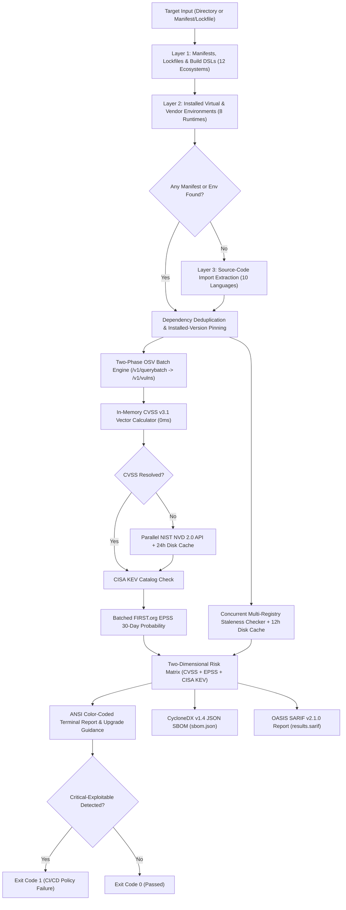

# Dependency Risk Tracker

**Dependency Risk Tracker (`dep-tracker`)** is a high-performance, zero-dependency Software Composition Analysis (SCA) and supply-chain vulnerability intelligence CLI tool written in Go. It discovers, analyzes, and prioritizes security vulnerabilities and maintenance risks across modern software projects in any programming language—even when a project lacks a lockfile or manifest.

The tool combines a **Three-Layer Intelligent Dependency Discovery Engine** with a **Two-Phase Batch OSV & NVD Vulnerability Pipeline**, an in-memory **CVSS v3.1 Vector Calculator**, **FIRST.org EPSS** 30-day exploitation probabilities, **CISA Known Exploited Vulnerabilities (KEV)** catalog alerts, **Multi-Registry Staleness Auditing**, and automated generation of **CycloneDX v1.4 SBOM** (`sbom.json`) and **OASIS SARIF v2.1.0** (`results.sarif`) compliance reports.

---

## Key Capabilities

* **Three-Layer Intelligent Dependency Discovery**:
  * **Layer 1 — Manifests, Lockfiles & Build DSLs**: Recursively detects and parses 30+ manifest, lockfile, and build DSL formats across **12 ecosystems** (npm/Yarn/pnpm, PyPI/Poetry/Pipenv/uv/Conda, Maven/Gradle, NuGet/.NET, Cargo/Rust, Go Modules, Composer/PHP, RubyGems/Bundler, Conan/vcpkg/CMake, Dart/Flutter Pub, Elixir Mix, and Swift Package Manager). Automatically resolves unpinned manifests against exact versions installed in local environments.
  * **Layer 2 — Installed Virtual & Vendor Environment Introspection**: Automatically inspects **8 installed environment formats** when lockfiles are absent or manifests use loose version specifiers (`>=`, `^`, `*`): Python `venv`/`.venv` (`*.dist-info/METADATA`), Node `node_modules/*/package.json`, .NET `obj/project.assets.json`, PHP `vendor/composer/installed.json`, Go `vendor/modules.txt`, Ruby `vendor/bundle/**/*.gemspec`, C/C++ `vcpkg_installed/vcpkg/status`, and Dart `.dart_tool/package_config.json`.
  * **Layer 3 — Zero-Manifest Source-Code Import Fallback**: Extracts third-party imports directly from source files across **10 programming language families** (`.py`, `.js`/`.ts`/`.jsx`/`.tsx`, `.go`, `.rs`, `.c`/`.cpp`/`.h`/`.hpp`, `.java`/`.kt`, `.cs`, `.php`, `.rb`, and `.dart`), filters out standard-library modules, maps import names to canonical registry packages, and resolves their versions via upstream registries.
* **High-Speed Two-Phase Batch OSV Engine**: Uses a pooled HTTP/2 transport (`MaxIdleConnsPerHost: 32`) to query `/v1/querybatch` in a single round-trip for all discovered packages and concurrently hydrates `/v1/vulns/<id>` only for packages with matching advisories.
* **Instant In-Memory CVSS v3.1 Vector Calculator & Cached NVD 2.0 Fallback**: Computes exact CVSS v3.1 base scores in memory (0 ms) from vector strings using official FIRST.org equations, with parallelized NIST NVD CVE 2.0 API fallback backed by a 24-hour local disk cache (`nvd_cache.json`).
* **CISA KEV & FIRST EPSS Exploitability Prioritization**: Cross-references every CVE against CISA's Known Exploited Vulnerabilities (KEV) catalog and queries FIRST.org EPSS in batches to compute a two-dimensional four-tier risk priority (`CRITICAL-EXPLOITABLE`, `HIGH`, `MEDIUM`, `LOW`).
* **Fast Multi-Registry Staleness Auditing**: Audits package maintenance health concurrently across npm, PyPI lightweight RSS release feeds (`~10 KB` instead of multi-MB JSON payloads), Maven Central, NuGet, Crates.io, Go Proxy, Packagist, RubyGems, ConanCenter, Pub.dev, and Hex.pm with a 12-hour local disk cache (`staleness_cache.json`), flagging packages untouched for > 2 years (730 days).
* **CycloneDX v1.4 SBOM & OASIS SARIF v2.1.0 Export**: Automatically generates `sbom.json` (with standardized PURLs and embedded CVSS/EPSS/KEV ratings) and `results.sarif` (for GitHub Code Scanning and CI/CD inline PR annotations).

---

## Supported Ecosystems & Three-Layer Discovery Matrix

### Layer 1: Manifests, Lockfiles & Build DSLs

| Ecosystem / Platform | Languages | Supported Lockfiles (Transitive) | Supported Manifests & Build DSLs (Direct) | Upstream Registry |
| :--- | :--- | :--- | :--- | :--- |
| **npm** | JavaScript, TypeScript | `package-lock.json`, `yarn.lock`, `pnpm-lock.yaml` | `package.json` | `registry.npmjs.org` |
| **PyPI** | Python | `poetry.lock`, `Pipfile.lock`, `uv.lock` | `requirements.txt`, `pyproject.toml` (PEP 621, Poetry, PDM), `Pipfile`, `setup.py`, `setup.cfg`, `environment.yml` | `pypi.org` (JSON & RSS) |
| **Maven / Gradle** | Java, Kotlin, Scala | `gradle.lockfile` | `pom.xml` (with `<properties>` & `<dependencyManagement>`), `build.gradle`, `build.gradle.kts`, `libs.versions.toml` | `search.maven.org` |
| **NuGet** | C#, F#, .NET | `packages.lock.json`, `paket.lock` | `*.csproj`, `*.fsproj`, `*.vbproj`, `packages.config`, `Directory.Packages.props` | `api.nuget.org` |
| **crates.io** | Rust | `Cargo.lock` | `Cargo.toml` | `crates.io` |
| **Go** | Go | `go.sum` | `go.mod` | `proxy.golang.org` |
| **Packagist** | PHP | `composer.lock` | `composer.json` | `repo.packagist.org` |
| **RubyGems** | Ruby | `Gemfile.lock` | `Gemfile`, `*.gemspec` | `rubygems.org` |
| **ConanCenter** | C, C++ | `conan.lock` | `conanfile.txt`, `conanfile.py`, `vcpkg.json`, `CMakeLists.txt` (`find_package` / `FetchContent`) | `conan.io` / GitHub |
| **Pub** | Dart, Flutter | `pubspec.lock` | `pubspec.yaml` | `pub.dev` |
| **Hex** | Elixir, Erlang | `mix.lock` | `mix.exs` | `hex.pm` |
| **SwiftURL** | Swift | `Package.resolved` | `Package.swift` | GitHub / SwiftPM |

### Layer 2: Installed Virtual & Vendor Environments

| Runtime / Ecosystem | Inspected Environment Path / Artifact | Resolution Behavior |
| :--- | :--- | :--- |
| **Python (`PyPI`)** | `venv/`, `.venv/`, `env/` (`site-packages/*.dist-info/METADATA`, `*.egg-info/PKG-INFO`) | Resolves exact installed versions & upgrades unpinned `requirements.txt` ranges |
| **Node.js (`npm`)** | `node_modules/*/package.json` & `node_modules/@scope/*/package.json` | Resolves installed direct & transitive packages when lockfiles are absent |
| **.NET (`NuGet`)** | `obj/project.assets.json` | Extracts exact resolved NuGet package graph from `libraries` / `targets` |
| **PHP (`Packagist`)** | `vendor/composer/installed.json` | Extracts exact installed Composer v1/v2 packages |
| **Go (`Go`)** | `vendor/modules.txt` | Extracts vendored Go module names and versions |
| **Ruby (`RubyGems`)** | `vendor/bundle/**/specifications/*.gemspec` | Extracts exact bundled Gem names and versions |
| **C/C++ (`ConanCenter`)** | `vcpkg_installed/vcpkg/status` | Parses Debian-control style `Package:` / `Version:` / `Status: install ok installed` blocks |
| **Dart / Flutter (`Pub`)** | `.dart_tool/package_config.json` | Extracts resolved Dart/Flutter packages and versions from `rootUri` cache paths |

### Layer 3: Zero-Manifest Source-Code Import Fallback

When a target directory contains raw source code with no manifest, lockfile, or installed environment, `dep-tracker` scans `.py`, `.js`/`.ts`/`.jsx`/`.tsx`, `.go`, `.rs`, `.c`/`.cpp`/`.cc`/`.cxx`/`.h`/`.hpp`, `.java`, `.kt`/`.kts`, `.cs`, `.php`, `.rb`, and `.dart` files, excludes standard-library imports, maps module names to canonical package identifiers (e.g., `cv2` $\rightarrow$ `opencv-python`, `sklearn` $\rightarrow$ `scikit-learn`, `bs4` $\rightarrow$ `beautifulsoup4`, `yaml` $\rightarrow$ `PyYAML`, `PIL` $\rightarrow$ `Pillow`), and resolves the latest upstream release version for vulnerability and staleness auditing.

---

## Architectural Workflow



---

## Risk Scoring Matrix

| Priority Tier | Qualification Criteria | Description |
| :--- | :--- | :--- |
| **CRITICAL-EXPLOITABLE** | Listed in **CISA KEV** **OR** (`CVSS >= 7.0` and `EPSS >= 0.20`) | Confirmed active in-the-wild exploitation or severe vulnerability with high 30-day exploit probability. Triggers CI/CD exit code `1`. |
| **HIGH** | `CVSS >= 7.0` (`EPSS < 0.20` and not in CISA KEV) | High technical severity flaws without immediate indicators of active weaponization. |
| **MEDIUM** | `4.0 <= CVSS < 7.0` | Moderate security defects requiring scheduled patching. |
| **LOW** | `0.0 < CVSS < 4.0` | Low-impact advisories or defense-in-depth findings. |
| **NONE** | No CVEs detected | Package has no known security advisories in official databases. |

---

## Installation & Distribution

`dep-tracker` is compiled as a single standalone executable with zero external runtime dependencies. It runs on Linux, macOS, and Windows without requiring Go, Python, or Node.js on the host machine.

### Method 1: Download Pre-compiled Binaries (No Go Required)

Download the latest standalone binary for your operating system and CPU architecture from [GitHub Releases](https://github.com/nyumuharon/dependency-tracker/releases/latest):

| Operating System | Architecture | Binary Download Link |
| :--- | :--- | :--- |
| **Linux** | x86_64 / amd64 | [`dep-tracker-linux-amd64`](https://github.com/nyumuharon/dependency-tracker/releases/latest/download/dep-tracker-linux-amd64) |
| **Linux** | ARM64 / aarch64 | [`dep-tracker-linux-arm64`](https://github.com/nyumuharon/dependency-tracker/releases/latest/download/dep-tracker-linux-arm64) |
| **Windows** | x86_64 / amd64 | [`dep-tracker-windows-amd64.exe`](https://github.com/nyumuharon/dependency-tracker/releases/latest/download/dep-tracker-windows-amd64.exe) |
| **macOS** | Apple Silicon (M1-M4) | [`dep-tracker-darwin-arm64`](https://github.com/nyumuharon/dependency-tracker/releases/latest/download/dep-tracker-darwin-arm64) |
| **macOS** | Intel (x86_64) | [`dep-tracker-darwin-amd64`](https://github.com/nyumuharon/dependency-tracker/releases/latest/download/dep-tracker-darwin-amd64) |

#### Quick Install Commands

**Linux (x86_64):**
```bash
curl -sSL -o dep-tracker https://github.com/nyumuharon/dependency-tracker/releases/latest/download/dep-tracker-linux-amd64
chmod +x dep-tracker
sudo mv dep-tracker /usr/local/bin/
```

**macOS (Apple Silicon M1-M4):**
```bash
curl -sSL -o dep-tracker https://github.com/nyumuharon/dependency-tracker/releases/latest/download/dep-tracker-darwin-arm64
chmod +x dep-tracker
sudo mv dep-tracker /usr/local/bin/
```

**Windows (PowerShell / Command Prompt):**
```powershell
curl.exe -L -o dep-tracker.exe https://github.com/nyumuharon/dependency-tracker/releases/latest/download/dep-tracker-windows-amd64.exe
.\dep-tracker.exe --help
```
*(Or download the `.zip` archive from [Releases](https://github.com/nyumuharon/dependency-tracker/releases/latest) and extract `dep-tracker-windows-amd64.exe`)*

---

### Method 2: Install via Go (`go install`)

If you have Go 1.22+ installed, install globally in one command:
```bash
go install github.com/nyumuharon/dependency-tracker/cmd/dep-tracker@latest
```
*(Make sure `$GOPATH/bin` or `%USERPROFILE%\go\bin` is in your `PATH`)*

---

### Method 3: Build from Source

```bash
git clone https://github.com/nyumuharon/dependency-tracker.git
cd dependency-tracker

# Linux / macOS
go build -ldflags="-s -w" -o dep-tracker ./cmd/dep-tracker

# Windows (PowerShell)
go build -ldflags="-s -w" -o dep-tracker.exe ./cmd/dep-tracker
```

---


## Usage

### 1. View Built-in Help and Commands
```bash
dep-tracker help
# or
dep-tracker --help
```

### 2. Recursive Project or Workspace Scan
Scan any project directory (manifests, virtual/vendor environments, or raw source code):
```bash
# Scan current directory
dep-tracker scan .

# Scan an external project directory
dep-tracker scan /path/to/project
```

### 3. Single Manifest, Lockfile, or Environment File Scan
```bash
dep-tracker scan package-lock.json
dep-tracker scan requirements.txt
dep-tracker scan pom.xml
dep-tracker scan Cargo.lock
dep-tracker scan obj/project.assets.json
```

### 4. Export CycloneDX SBOM & GitHub SARIF
```bash
# Export CycloneDX v1.4 JSON SBOM and OASIS SARIF v2.1.0 report
dep-tracker scan . --sbom reports/sbom.json --sarif reports/results.sarif
```

### 5. Machine-Readable JSON Output (for CI/CD Pipelines)
```bash
# Output raw JSON to stdout (status logs go to stderr)
dep-tracker scan . --json > scan-report.json
```

### 6. Filter Unmaintained / Stale Packages Only
```bash
# Audit dependencies with no release in over 2 years (730 days)
dep-tracker scan . --stale-only
```

### 7. Version Information
```bash
dep-tracker version
# or
dep-tracker -v
```

---

## Testing

Run the full unit, multi-ecosystem parser, and concurrency race-detector test suite:
```bash
go test -v -race ./...
```

---

## License

This project is licensed under the MIT License.
